# Dokumen Tahap 1 & Tahap 2 Metode Waterfall
## LokaKos: Sistem Informasi Pemesanan Kos Berbasis Web dengan Multi-Mitra Pemilik Kos (Studi Kasus: Kawasan Universitas Muhammadiyah Yogyakarta)

> Versi Dokumen: **3.1** (Disinkronkan dengan skema database lengkap: **24 tabel domain LokaKos** dari **21 file migrasi** + **4 tabel bawaan Laravel** pada MySQL `lokakos_db` dan implementasi Laravel 10 dengan **46 test otomatis lulus**).

Dokumen ini menjadi acuan kerja bersama tim (3 orang) dan bahan dasar penyusunan laporan proyek mata kuliah pada fase **Requirement Analysis** dan **System Design** yang selaras dengan implementasi aplikasi LokaKos.

---

## Ringkasan Keputusan Arsitektur

| Aspek | Keputusan | Alasan Teknis & Bisnis |
| :--- | :--- | :--- |
| Nama Aplikasi | **LokaKos** (LokaKos UMY) | Singkat, lokal, dan menonjolkan pencarian kos berbasis area sekitar Kampus Terpadu UMY. |
| Model Unit Kamar | Per Tipe Kamar berbasis stok (`total_rooms`, `available_rooms`) + rincian operasional (`deposit_amount`, `electricity_included`, `max_occupancy`, `room_image_path`) | Satu properti kos dapat memiliki beberapa tipe kamar dengan tarif, kapasitas, kebijakan listrik, deposit, dan foto berbeda; stok berkurang otomatis saat pembayaran valid serta dapat disesuaikan cepat oleh Mitra. |
| Metode Pembayaran | Transfer Manual + Unggah Bukti Bayar | Sederhana untuk skala proyek kuliah namun tetap merepresentasikan alur transaksi lengkap. |
| Alur Dana Multi-Mitra | Langsung ke Rekening Mitra, diverifikasi Mitra, dipantau Admin | Sesuai praktik pemilik kos sekitar UMY; Mitra aktif memverifikasi transaksi dan Admin bertindak sebagai pengawas serta moderator. |
| Stack Aplikasi | Laravel 10.50, PHP 8.3, MySQL 8.4, Blade, Tailwind CSS, Alpine.js | Alur MVC Laravel 10 terlihat jelas untuk penilaian akademik, stabil penuh pada PHP 8.3, dan fleksibel dikustomisasi sesuai `DESIGN.md`. |
| Autentikasi & Akses | Laravel Breeze, Middleware Role, Laravel Policy (`BoardingHousePolicy`, `BookingPolicy`) | Memisahkan 3 peran (`admin`, `mitra`, `penyewa`), menerapkan isolasi ketat antar-mitra, serta menyesuaikan workspace onboarding Mitra baru (`0` kos). |
| Peta & Jarak ke UMY | Leaflet.js + OpenStreetMap + Rumus Haversine | Tanpa biaya API; jarak ke titik Kampus Terpadu UMY (Tamantirto, `-7.8113, 110.3216`) dihitung otomatis dari koordinat kos. |
| Dokumen PDF & QR | `barryvdh/laravel-dompdf` + `chillerlan/php-qrcode` | Untuk mencetak Invoice PDF ber-QR verifikasi keaslian, Surat Perjanjian Sewa PDF, Poster QR Kos siap cetak A4, serta laporan keuangan PDF dan CSV (Excel). |

---

# TAHAP 1: REQUIREMENT ANALYSIS (ANALISIS KEBUTUHAN)

## 1.1 Identifikasi Masalah (Konteks Kawasan UMY)

1. **Sisi Pencari Kos (Mahasiswa UMY):** Informasi kos di sekitar Kampus Terpadu UMY (Tamantirto, Kasihan, Bantul) masih tersebar di spanduk fisik, pesan WhatsApp, dan media sosial. Mahasiswa sulit memeriksa ketersediaan kamar secara langsung, membandingkan jarak ke kampus, memfilter area sekitar (Ngebel, Brajan, Geblagan, Tamantirto, Rukeman, Ambarketawang, Kasihan, Ringroad Barat), menyimpan kos incaran, maupun mengecek ketentuan khusus seperti kos Putra/Putri/Campur, Syariah, biaya deposit, dan status listrik.
2. **Sisi Pemilik Kos (Mitra):** Pengelolaan pemesanan dan pengecekan bukti transfer masih dilakukan secara manual lewat chat sehingga rawan tercecer, sulit melacak sisa kamar per tipe, dan tidak memiliki rekap pemasukan berkala.
3. **Sisi Pengelola Platform (Admin):** Diperlukan mekanisme verifikasi identitas pemilik kos, moderasi data kos sebelum tayang (serta opsi menarik sementara kos ke draf bila ada pelanggaran), dan pengawasan transaksi lintas mitra agar informasi yang diterima mahasiswa dapat dipertanggungjawabkan.

## 1.2 Kebutuhan Fungsional (Functional Requirements)

### A. Modul Autentikasi & Hak Akses
- **FR-01:** Sistem menyediakan registrasi akun untuk Penyewa (Mahasiswa) dan pendaftaran calon Mitra Pemilik Kos (disertai unggah foto KTP/identitas dan data rekening bank).
- **FR-02:** Sistem menyediakan autentikasi login dan logout multi-role (`admin`, `mitra`, `penyewa`) serta mengarahkan pengguna ke `/dashboard` yang menampilkan workspace sesuai perannya.
- **FR-03:** Pengguna yang login dapat memperbarui data profil dan kata sandi; Mitra dapat memperbarui data usaha, foto KTP, dan rekening penerima transfer.
- **FR-04:** Sistem membatasi akses berdasarkan peran (`RoleMiddleware`) dan kepemilikan sumber daya (`BoardingHousePolicy` dan `BookingPolicy`) sehingga Mitra tidak dapat melihat, mengubah, atau memverifikasi kos, tipe kamar, maupun pesanan milik Mitra lain.

### B. Modul Pengunjung / Publik
- **FR-05:** Pengunjung dapat melihat katalog daftar kos berstatus `published` pada beranda dan halaman pencarian (`/kos`).
- **FR-06:** Pengunjung dapat mencari dan memfilter kos berdasarkan kata kunci, area sekitar UMY, tipe penghuni (`putra`, `putri`, `campur`), kategori Syariah, fasilitas, rentang harga bulanan, serta mengurutkan berdasarkan jarak terdekat ke UMY atau harga terendah.
- **FR-07:** Pengunjung dapat membuka halaman detail kos (`/kos/{slug}`) yang memuat galeri foto, peta lokasi interaktif beserta jarak ke UMY, fasilitas umum, peraturan kos, kontak pengelola khusus kos (nama kontak, nomor WhatsApp, nomor telepon langsung `tel:`, jam layanan survei), tautan **Tanya via WhatsApp** dan **Tanya Tipe Ini via WA** dengan pesan otomatis berbeda dan menarik per properti/kamar, rincian tipe kamar (ukuran, kapasitas penghuni, kebijakan listrik, uang jaminan/deposit, foto tipe kamar, sisa stok), serta ulasan penghuni terverifikasi.

### C. Modul Penyewa (Mahasiswa)
- **FR-08:** Penyewa dapat membuat pesanan pada tipe kamar yang memiliki `available_rooms > 0` dengan memilih tanggal mulai masuk dan durasi sewa (`1`, `3`, `6`, atau `12` bulan). Sistem menghitung total tagihan secara otomatis.
- **FR-09:** Sistem menerbitkan kode booking unik dan menampilkan detail instruksi transfer ke rekening Mitra pemilik kos terkait.
- **FR-10:** Penyewa dapat mengunggah bukti transfer manual (JPG/PNG/PDF, maks 2 MB) beserta nama bank pengirim dan nama pemilik rekening pengirim.
- **FR-11:** Penyewa dapat melihat ringkasan pesanan di dashboard (lengkap dengan pelacak progres 4 tahap), riwayat pesanan, membatalkan pesanan selama status masih `pending_payment`, dan mengunduh Bukti Pemesanan/Invoice PDF ketika status `confirmed` atau `completed`.
- **FR-12:** Penyewa dapat memberikan rating (1 sampai 5) dan ulasan teks untuk kos setelah pesanan berstatus `completed` (dibatasi 1 ulasan per transaksi booking).
- **FR-25:** Penyewa dapat menyimpan atau menghapus kos berstatus `published` ke daftar kos favorit (`saved_boarding_houses`) melalui tombol **Simpan Kos** serta mengelolanya di `/penyewa/favorit` dan ringkasan dashboard.
- **FR-26:** Pengunjung dan Penyewa dapat menggunakan **Peta Katalog Interaktif** seluruh kos sekitar UMY, **Bandingkan 2 s.d. 3 Kos** (`/kos/bandingkan`), melihat estimasi waktu tempuh jalan kaki/motor & penanda sekitar kampus, melihat **Kalkulator Biaya Awal & Patungan**, mengajukan **Jadwal Survei Lokasi** (`survey_bookings`), bertanya pada **Q&A Publik** (`boarding_questions`), mendaftar **Daftar Tunggu Kamar Penuh** (`room_waitlists`), memakai **Kode Promo** & mengunggah **KTM UMY/KTP** saat booking, mengunduh **Surat Perjanjian Sewa PDF** & **Verifikasi QR Invoice**, mengajukan **Perpanjangan Sewa**, mengirim **Laporan Perbaikan Kamar** (`maintenance_tickets`), serta melaporkan listing tidak sesuai (`listing_reports`).
- **FR-27:** Mitra dapat mengelola **Nomor Kamar Fisik** (`room_units`), menindaklanjuti jadwal survei & keluhan penghuni, membuat **Promo & Voucher** (`promos`), menerbitkan **Papan Pengumuman Kos** (`boarding_announcements`) & menjawab Q&A, mencatat **Pengeluaran Operasional / Buku Kas** (`mitra_expenses`) + ekspor CSV, melihat **Skor Kelengkapan Listing**, serta mencetak **Poster QR Kos PDF**.
- **FR-28:** Admin dapat memberi lencana **Terverifikasi Lapangan** pada kos, menindaklanjuti **Laporan Listing Tidak Sesuai** (`listing_reports`), memeriksa **Audit Trail Aktivitas Sistem** (`activity_logs`), memantau **Grafik Analitik Area UMY** (Chart.js), mengekspor transaksi ke **CSV (Excel)**, dan seluruh peran terhubung ke **Pusat Notifikasi In-App** (`user_notifications`) serta **Auto-Expire Pesanan 24 Jam** (`lokakos:expire-bookings`).

### D. Modul Mitra Pemilik Kos
- **FR-13:** Mitra yang akunnya berstatus `approved` dapat mengakses dashboard pengelolaan kos. Jika Mitra baru belum memiliki kos (`0` kos), sistem menampilkan tampilan onboarding terpandu (fokus tambah kos pertama dan kelengkapan profil/rekening); setelah memiliki kos, tampil 4 ringkasan metrik nyata, antrean pembayaran menunggu verifikasi, rincian properti beserta tipe kamar, dan daftar penghuni terkonfirmasi.
- **FR-14:** Mitra dapat mengelola data properti kos miliknya (tambah, lihat, ubah, hapus), mengunggah banyak foto, memilih fasilitas kos, mengatur kontak pengelola per kos (nama pengelola, nomor WhatsApp khusus kos, telepon alternatif, jam layanan/survei, serta template pesan otomatis WhatsApp kustom opsional), dan menentukan titik koordinat di peta Leaflet.js untuk menghitung jarak ke UMY secara otomatis.
- **FR-15:** Mitra dapat mengelola tipe kamar pada properti miliknya (tambah, ubah penuh, hapus): nama tipe, ukuran kamar, tarif per durasi sewa, uang jaminan (`deposit_amount`), kebijakan listrik (`electricity_included`), kapasitas penghuni (`max_occupancy`), jumlah total kamar, jumlah kamar tersedia, foto khusus tipe kamar (`room_image_path`), fasilitas kamar, serta penyesuaian cepat stok kamar (`-1`/`+1`).
- **FR-16:** Mitra dapat melihat daftar pesanan masuk khusus properti miliknya beserta pratinjau bukti transfer yang diunggah Penyewa.
- **FR-17:** Mitra dapat memverifikasi bukti pembayaran:
  - Jika disetujui: status pembayaran menjadi `verified`, status pesanan menjadi `confirmed`, dan `available_rooms` berkurang 1 secara otomatis.
  - Jika ditolak: Mitra wajib mengisi catatan alasan penolakan (`rejection_note`), status pembayaran menjadi `rejected`, dan stok kamar tidak berkurang.
  - Mitra dapat menandai pesanan `confirmed` menjadi `completed` ketika penyewa telah melakukan check-in.
- **FR-18:** Mitra dapat melihat rekap pemasukan berdasarkan rentang tanggal dan mengunduh laporan pemasukan dalam format PDF (`/mitra/laporan/pdf`).

### E. Modul Administrator
- **FR-19:** Admin dapat meninjau antrean pendaftaran Mitra baru (`/admin/mitra`), melihat berkas identitas, lalu menyetujui (`approved`) atau menolak (`rejected`) dengan catatan alasan.
- **FR-20:** Admin dapat memoderasi listing kos yang diajukan Mitra (`/admin/kos`): menyetujui `pending_review` menjadi `published`, menolak menjadi `rejected` dengan catatan perbaikan, serta menarik sementara kos tayang kembali ke status `draft` (`unpublish`).
- **FR-21:** Admin dapat mengelola master data Area/Dusun sekitar UMY (`areas`: tambah, edit inline, dan hapus aman) di `/admin/master`.
- **FR-22:** Admin dapat mengelola master data Fasilitas kos dan fasilitas kamar (`facilities`) di `/admin/master`.
- **FR-23:** Admin dapat memantau daftar pengguna (termasuk aktif/nonaktifkan akun), seluruh transaksi pemesanan lintas mitra, serta memoderasi ulasan (menyembunyikan/menampilkan kembali ulasan) di `/admin/monitoring`.
- **FR-24:** Admin dapat melihat ringkasan data operasional riil di dashboard (termasuk badge jumlah antrean di sidebar) dan mencetak laporan rekap transaksi platform per periode dalam format PDF (`/admin/laporan/pdf`).

## 1.3 Kebutuhan Non-Fungsional (Non-Functional Requirements)

| Kode | Kategori | Deskripsi Kebutuhan |
| :--- | :--- | :--- |
| **NFR-01** | Keamanan | Kata sandi dienkripsi dengan Bcrypt; seluruh form dilindungi token CSRF Laravel; validasi MIME type dan ukuran file unggahan maksimal 2 MB; akses multi-role dan kepemilikan data antar-mitra dikunci di sisi server. |
| **NFR-02** | Integritas Data | Proses konfirmasi pembayaran dan pengurangan stok kamar wajib dibungkus transaksi database (`DB::transaction`) dengan baris terkunci (`lockForUpdate`) untuk mencegah stok bernilai negatif; penyesuaian stok manual divalidasi pada rentang `0..total_rooms`. |
| **NFR-03** | Aksesibilitas & UI | Antarmuka responsif untuk layar ponsel (`375px`), tablet, dan desktop (`1440px`) dengan target sentuh minimal 44px, kontras warna memenuhi WCAG AA pada Light Mode dan Dark Mode, dapat dinavigasi dengan keyboard, serta menyediakan empty state dan error state yang jelas. |
| **NFR-04** | Kompatibilitas | Aplikasi berjalan stabil pada PHP 8.3, MySQL 8.4, Laravel 10, dan browser modern tanpa ketergantungan API peta berbayar. |

---

# TAHAP 2: SYSTEM DESIGN (PERANCANGAN SISTEM)

## 2.1 Use Case Diagram

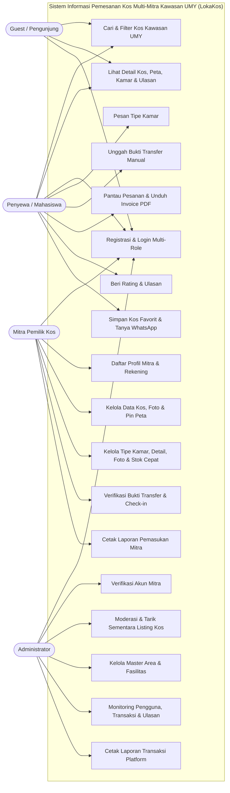

---

## 2.2 Activity Diagram (4 Alur Kritis)

### Activity Diagram 1: Pendaftaran, Verifikasi, & Onboarding Mitra

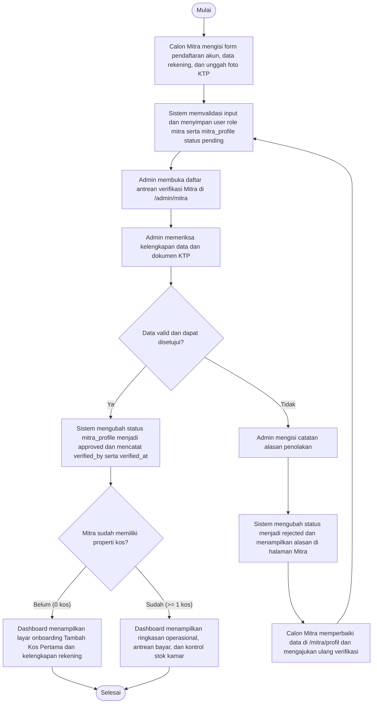

### Activity Diagram 2: Penambahan Kos, Detail Tipe Kamar, & Moderasi Admin

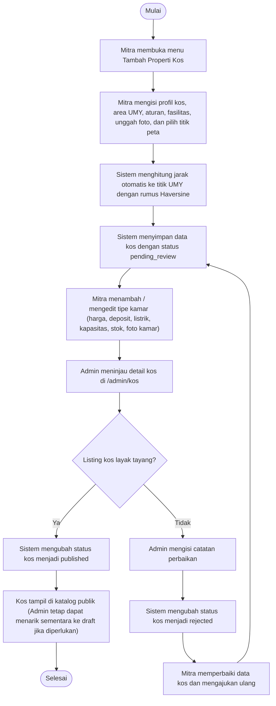

### Activity Diagram 3: Pencarian, Simpan Favorit, Pemesanan, & Unggah Bukti Transfer

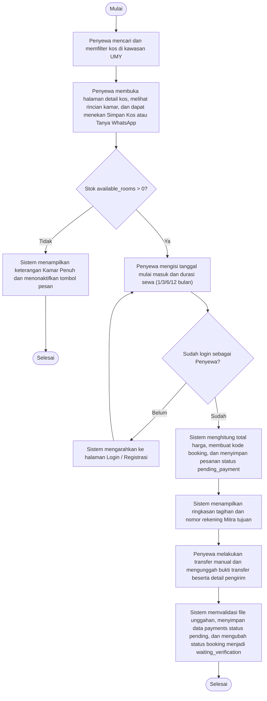

### Activity Diagram 4: Verifikasi Pembayaran, Pengurangan Stok, & Check-in

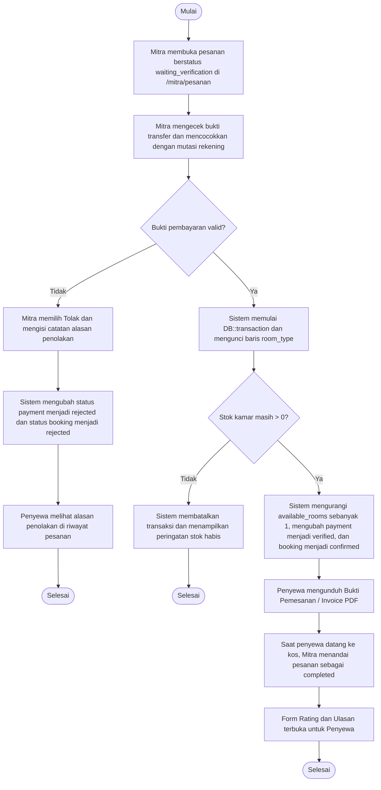

---

## 2.3 Sequence Diagram (3 Alur Utama)

### Sequence Diagram 1: Login & Otorisasi Multi-Role + Isolasi Mitra

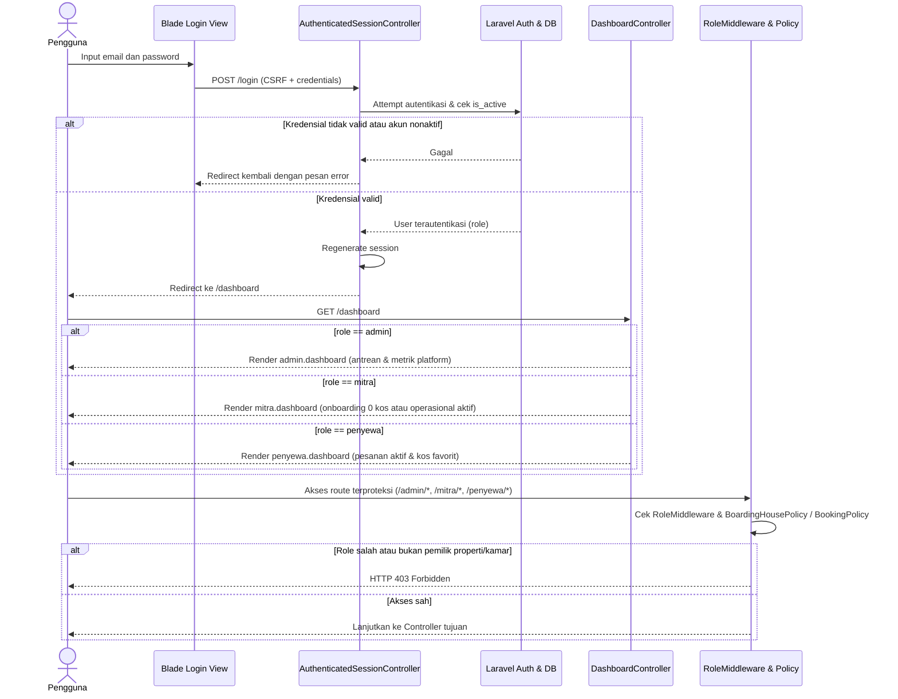

### Sequence Diagram 2: Pemesanan Kamar & Unggah Bukti Pembayaran

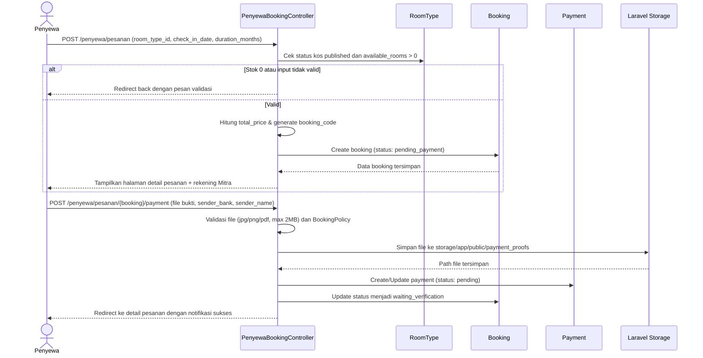

### Sequence Diagram 3: Verifikasi Pembayaran Transaksional oleh Mitra

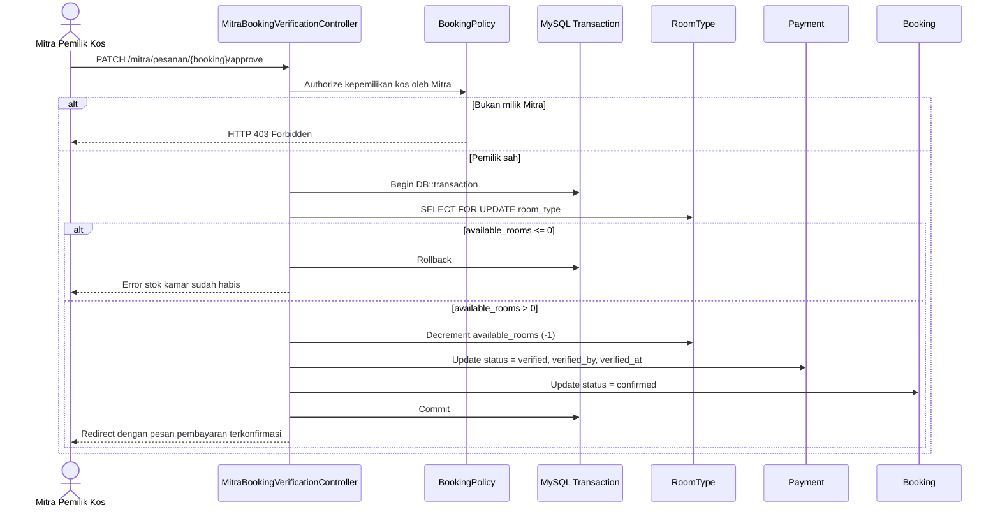

---

## 2.4 State Diagram Status Pemesanan

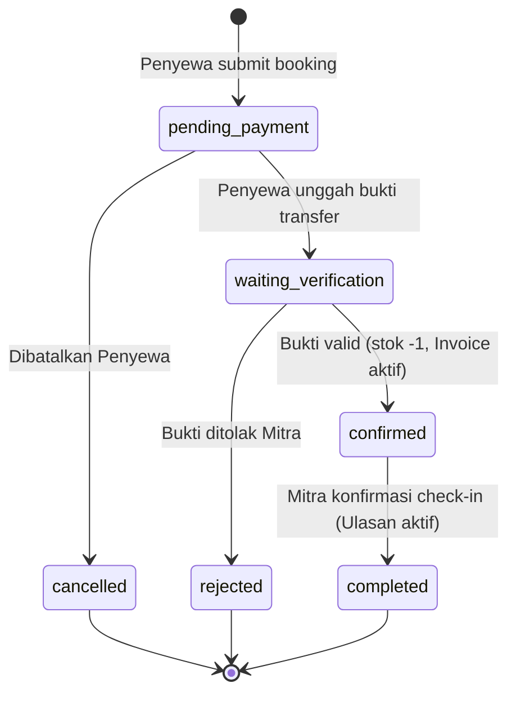

---

## 2.5 Class Diagram (Model Eloquent Laravel)

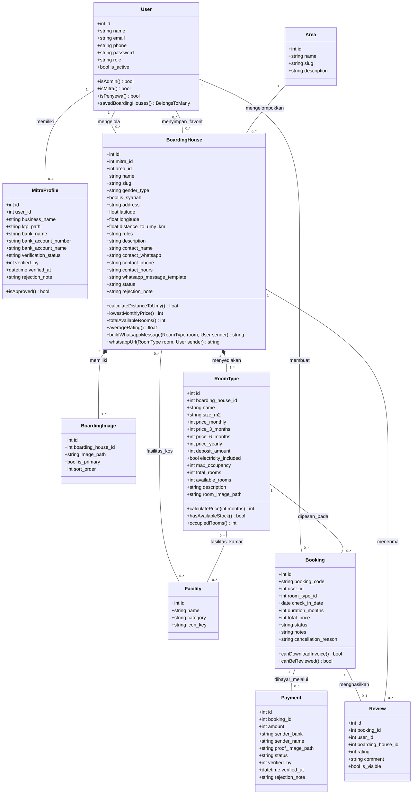

---

## 2.6 Entity Relationship Diagram (ERD)

Skema database LokaKos terdiri atas **24 tabel domain** (13 tabel inti + 11 tabel operasional, analitik, dan tata kelola).

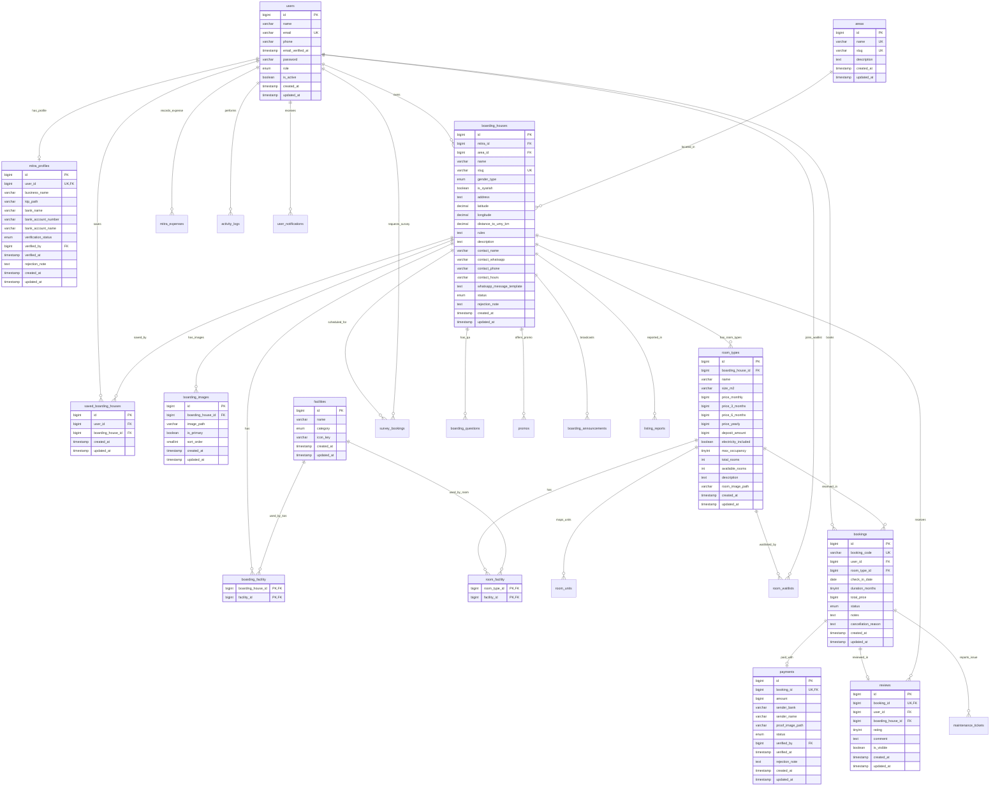

---

## 2.7 Kamus Data Lengkap (Sinkron dengan MySQL `lokakos_db`)

### A. 24 Tabel Domain LokaKos (Inti + Operasional & Tata Kelola)

| No | Tabel | Kolom Kunci, Tipe Data, & Indeks | Catatan Aturan Validasi & Bisnis |
| :---: | :--- | :--- | :--- |
| 1 | `users` | `id` (PK), `name` (varchar 255), `email` (unique), `phone` (nullable varchar 25), `role`: `enum('admin','mitra','penyewa')` default `penyewa`, `is_active`: `boolean default true` | `email` unik; `phone` dipakai untuk kontak WhatsApp kos/penyewa. |
| 2 | `mitra_profiles` | `id` (PK), `user_id` (unique FK -> `users.id` cascade), `business_name` (varchar 150), `ktp_path` (nullable varchar 255), `bank_name` (varchar 60), `bank_account_number` (varchar 50), `bank_account_name` (varchar 120), `verification_status`: `enum('pending','approved','rejected')`, `verified_by` (nullable FK -> `users.id` nullOnDelete), `verified_at` (nullable timestamp), `rejection_note` (nullable text) | Hanya user dengan `role = mitra` yang memiliki baris profil usaha & rekening tujuan transfer. |
| 3 | `areas` | `id` (PK), `name` (unique varchar 100), `slug` (unique varchar 120), `description` (nullable text) | Data awal (`AreaSeeder`): Ngebel, Brajan, Geblagan, Tamantirto, Rukeman, Kasihan, Ambarketawang, Ringroad Barat. |
| 4 | `boarding_houses` | `id` (PK), `mitra_id` (FK cascade), `area_id` (FK restrict), `slug` (unique varchar 180), `gender_type`, `is_syariah`, `latitude`/`longitude`, **`google_maps_url`** (nullable varchar 500), `distance_to_umy_km`, `nearby_landmarks`, `contact_name`, `contact_whatsapp`, `contact_phone`, `contact_hours`, `whatsapp_message_template`, `status`, **`is_field_verified`** (boolean), **`field_verified_at`** (nullable timestamp) | Jarak Haversine & estimasi waktu jalan/motor ke UMY otomatis; mendukung impor titik presisi dari link Google Maps (`maps.app.goo.gl`, `!3d/!4d`, `@lat,lng`, DMS, alamat) via `GoogleMapsResolver`, kontak WA per-kos dengan pesan otomatis unik, serta lencana Verifikasi Lapangan Admin. |
| 5 | `boarding_images` | `id` (PK), `boarding_house_id` (FK cascade), `image_path` (varchar 255), `is_primary` (boolean), `sort_order` (unsignedSmallInteger) | Mendukung multi-foto properti kos dan penentuan gambar utama. |
| 6 | `room_types` | `id` (PK), `boarding_house_id` (FK cascade), `name`, `size_m2`, `price_monthly`/`3_months`/`6_months`/`yearly`, `deposit_amount`, `electricity_included`, `max_occupancy`, `total_rooms`/`available_rooms`, `description`, `room_image_path` | `available_rooms` wajib pada rentang `0..total_rooms`; kenaikan stok dari `0` otomatis mengirim notifikasi ke daftar tunggu (`room_waitlists`). |
| 7 | `facilities` | `id` (PK), `name` (varchar 100), `category`: `enum('kos','kamar')`, `icon_key` (nullable varchar 50); unique `(name, category)` | Memisahkan fasilitas umum properti (`kos`) dan fasilitas dalam kamar (`kamar`). |
| 8 | `boarding_facility` | Composite PK (`boarding_house_id`, `facility_id`) | Tabel pivot many-to-many properti kos dan fasilitas. |
| 9 | `room_facility` | Composite PK (`room_type_id`, `facility_id`) | Tabel pivot many-to-many tipe kamar dan fasilitas. |
| 10 | `saved_boarding_houses` | `id` (PK), `user_id` (FK), `boarding_house_id` (FK); unique `(user_id, boarding_house_id)` | Daftar kos favorit Penyewa tanpa duplikasi. |
| 11 | `bookings` | `id` (PK), `booking_code` (unique), `user_id`, `room_type_id`, **`parent_booking_id`** (nullable FK self), `check_in_date`, `duration_months`, `total_price`, **`promo_code`**, **`discount_amount`**, `status`, **`payment_due_at`** (24 jam), `notes`, **`identity_card_path`** (KTM/KTP), `cancellation_reason`, **`verification_token`** (unique 64 char) | Mendukung kode promo, unggah KTM UMY/KTP, perpanjangan sewa, batas waktu bayar 24 jam (`lokakos:expire-bookings`), dan verifikasi QR Invoice. |
| 12 | `payments` | `id` (PK), `booking_id` (unique FK), `amount`, `sender_bank`, `sender_name`, `proof_image_path`, `status`, `verified_by`, `verified_at`, `rejection_note` | Validasi unggahan `mimes:jpg,jpeg,png,pdf|max:2048`. |
| 13 | `reviews` | `id` (PK), `booking_id` (unique FK), `user_id`, `boarding_house_id`, `rating` (1..5), `comment`, `is_visible` | 1 transaksi `completed` hanya dapat mengirim 1 ulasan. |
| 14 | `survey_bookings` | `id` (PK), `user_id`, `boarding_house_id`, `room_type_id` (nullable), `preferred_date`, `preferred_time`, `notes`, `status` (`pending`/`approved`/`rescheduled`/`rejected`/`completed`/`cancelled`), `mitra_response` | Jadwal kunjungan survei lokasi calon penghuni sebelum melakukan pemesanan. |
| 15 | `boarding_questions` | `id` (PK), `boarding_house_id`, `user_id`, `question`, `answer` (nullable), `answered_by` (nullable FK), `answered_at`, `is_visible` | Kolom Tanya Jawab Publik (Q&A) pada detail kos yang dijawab Mitra. |
| 16 | `room_waitlists` | `id` (PK), `user_id`, `room_type_id`, `status` (`waiting`/`notified`/`cancelled`), `notified_at`; unique `(user_id, room_type_id)` | Daftar tunggu kamar penuh dengan notifikasi otomatis saat stok kembali > 0. |
| 17 | `room_units` | `id` (PK), `room_type_id`, `unit_code` (varchar 30), `floor_label`, `status` (`available`/`occupied`/`maintenance`), `current_booking_id`, `tenant_name`, `lease_ends_at`, `notes`; unique `(room_type_id, unit_code)` | Pemetaan nomor kamar fisik (`A-01`, `A-02`) beserta nama penghuni dan akhir masa sewa. |
| 18 | `maintenance_tickets` | `id` (PK), `booking_id`, `boarding_house_id`, `user_id`, `category`, `title`, `description`, `photo_path`, `status` (`open`/`in_progress`/`resolved`), `mitra_note`, `resolved_at` | Laporan perbaikan/keluhan fasilitas kamar dari penghuni aktif kepada Mitra. |
| 19 | `promos` | `id` (PK), `mitra_id`, `boarding_house_id` (nullable), `code` (unique), `title`, `discount_type` (`fixed`/`percent`), `discount_value`, `min_duration_months`, `valid_from`, `valid_until`, `is_active` | Kode voucher diskon paket sewa/awal semester khusus kos milik Mitra. |
| 20 | `boarding_announcements` | `id` (PK), `boarding_house_id`, `mitra_id`, `title`, `body`, `is_pinned` | Papan pengumuman kos untuk penghuni aktif yang tampil otomatis di dashboard Penyewa. |
| 21 | `mitra_expenses` | `id` (PK), `mitra_id`, `boarding_house_id` (nullable), `category`, `description`, `amount`, `expense_date` | Buku kas pengeluaran operasional Mitra untuk menghitung laba bersih pada laporan PDF. |
| 22 | `listing_reports` | `id` (PK), `boarding_house_id`, `reporter_user_id` (nullable), `reporter_name`, `reason`, `details`, `status` (`open`/`resolved`/`dismissed`), `admin_note`, `handled_by`, `handled_at` | Pelaporan ketidaksesuaian harga, stok, atau foto kos dari publik/penyewa ke Admin. |
| 23 | `activity_logs` | `id` (PK), `user_id` (nullable), `action`, `subject_type`, `subject_id`, `description`, `metadata` (json), `ip_address`, `created_at` | Audit trail otomatis seluruh tindakan penting Admin, Mitra, Penyewa, dan Scheduler. |
| 24 | `user_notifications` | `id` (PK), `user_id`, `type`, `title`, `body`, `action_url`, `read_at`; index `(user_id, read_at)` | Pusat notifikasi in-app dengan indikator belum dibaca pada bilah atas panel. |

### B. Ringkasan 21 File Migrasi Domain & 4 Tabel Bawaan Framework

Selain 4 tabel standar Laravel (`migrations`, `password_reset_tokens`, `failed_jobs`, `personal_access_tokens`), seluruh 24 tabel domain dibentuk melalui 21 file migrasi berurutan di `database/migrations/`:

1. `2026_11_21_000001_add_lokakos_fields_to_users_table.php` (`users`: tambah `phone`, `role`, `is_active`)
2. `2026_11_21_000002_create_mitra_profiles_table.php` (`mitra_profiles`)
3. `2026_11_21_000003_create_areas_table.php` (`areas`)
4. `2026_11_21_000004_create_boarding_houses_table.php` (`boarding_houses`)
5. `2026_11_21_000005_create_boarding_images_table.php` (`boarding_images`)
6. `2026_11_21_000006_create_room_types_table.php` (`room_types`)
7. `2026_11_21_000007_create_facilities_table.php` (`facilities`)
8. `2026_11_21_000008_create_facility_pivots_table.php` (`boarding_facility`, `room_facility`)
9. `2026_11_21_000009_create_bookings_table.php` (`bookings`)
10. `2026_11_21_000010_create_payments_table.php` (`payments`)
11. `2026_11_21_000011_create_reviews_table.php` (`reviews`)
12. `2026_11_21_000012_add_mamikos_details_to_room_types_table.php` (`room_types`: tambah `deposit_amount`, `electricity_included`, `max_occupancy`, `room_image_path`)
13. `2026_11_21_000013_create_saved_boarding_houses_table.php` (`saved_boarding_houses`)
14. `2026_11_21_000014_add_contact_fields_to_boarding_houses_table.php` (`boarding_houses`: tambah `contact_name`, `contact_whatsapp`, `contact_phone`, `contact_hours`, `whatsapp_message_template`)
15. `2026_11_21_000015_add_governance_and_booking_enhancements.php` (`boarding_houses`: tambah `is_field_verified`, `field_verified_at`, `nearby_landmarks`; `bookings`: tambah `parent_booking_id`, `identity_card_path`, `promo_code`, `discount_amount`, `payment_due_at`, `verification_token`)
16. `2026_11_21_000016_create_survey_bookings_table.php` (`survey_bookings`)
17. `2026_11_21_000017_create_boarding_questions_and_waitlists_tables.php` (`boarding_questions`, `room_waitlists`)
18. `2026_11_21_000018_create_room_units_and_maintenance_tables.php` (`room_units`, `maintenance_tickets`)
19. `2026_11_21_000019_create_promos_announcements_and_expenses_tables.php` (`promos`, `boarding_announcements`, `mitra_expenses`)
20. `2026_11_21_000020_create_governance_tables.php` (`listing_reports`, `activity_logs`, `user_notifications`)
21. `2026_11_21_000021_add_google_maps_url_to_boarding_houses_table.php` (`boarding_houses`: tambah `google_maps_url`)

---

## 2.8 Kerangka Skenario Uji Black-Box (Acuan Tahap 4)

Tabel ringkasan ini menjadi dasar skenario uji rinci (28 kasus uji fungsional + 4 checklist UI) pada dokumen `docs/TEST_PLAN.md`.

| ID Uji | Ref FR | Modul | Skenario & Input Uji | Hasil yang Diharapkan | Tipe |
| :--- | :--- | :--- | :--- | :--- | :--- |
| **TC-01** | FR-01 | Auth / Mitra | Calon Mitra mengisi form registrasi lengkap + unggah foto KTP format JPG < 2 MB | Akun tersimpan dengan role `mitra` dan status `pending`; belum bisa mempublikasikan kos sebelum disetujui Admin | Positif |
| **TC-02** | FR-04 | Keamanan Role | Pengguna login sebagai `mitra` lalu mengakses langsung URL `/admin/mitra` atau `/admin/kos` | Sistem menolak akses dengan respons HTTP 403 Forbidden | Negatif |
| **TC-03** | FR-04 | Isolasi Multi-Mitra | Mitra A (`mitra3@lokakos.test`) mencoba mengakses `/mitra/kos/1/edit` atau `/mitra/kos/1/kamar/1/edit` milik Mitra B | Laravel Policy menolak permintaan dengan HTTP 403 Forbidden | Negatif |
| **TC-04** | FR-13, FR-19 | Verifikasi & Onboarding | Admin menyetujui pendaftaran Mitra baru; Mitra dengan `0` kos membuka `/dashboard` | Status menjadi `approved`; dashboard Mitra baru menampilkan layar onboarding **Tambah Kos Pertama** tanpa menu operasional kosong | Positif |
| **TC-05** | FR-14, FR-20 | Moderasi & Unpublish Kos | Mitra menambah kos baru (`pending_review`), Admin menyetujui (`published`), lalu Admin menekan **Tarik Sementara (Draf)** | Sebelum disetujui tidak tampil di publik; setelah disetujui tampil; setelah ditarik ke `draft` kembali tersembunyi dari katalog publik | Positif & Negatif |
| **TC-06** | FR-14 | Peta & Haversine | Mitra menaruh pin lokasi kos di wilayah Ngebel (`-7.8145, 110.3190`) dan menyimpan data | Sistem otomatis menyimpan `distance_to_umy_km` sesuai perhitungan Haversine ke koordinat UMY | Positif |
| **TC-07** | FR-06 | Katalog Publik | Pengunjung memilih filter Area = `Geblagan`, Tipe = `Putri`, dan kategori `Syariah` | Hanya kos berstatus `published` yang memenuhi seluruh kriteria filter yang tampil | Positif |
| **TC-08** | FR-15 | Edit Kamar & Stok Cepat | Mitra mengedit detail kamar (`deposit_amount`, `electricity_included`, `max_occupancy`, `room_image`) dan menekan tombol stok `-` / `+` | Perubahan tersimpan di `room_types`; stok berubah aman pada rentang `0..total_rooms` | Positif |
| **TC-09** | FR-08 | Booking Stok Habis | Penyewa mencoba memesan tipe kamar dengan `available_rooms = 0` (baik lewat UI maupun manipulasi POST) | Tombol pesan nonaktif di UI dan validasi server menolak pemesanan | Negatif |
| **TC-10** | FR-10 | Unggah Bukti Bayar | Penyewa mengunggah file `.exe` atau gambar berukuran 5 MB pada form bukti transfer | Sistem menolak file dan menampilkan pesan validasi format/ukuran yang jelas | Negatif |
| **TC-11** | FR-17, NFR-02 | Verifikasi Bayar | Mitra menyetujui bukti pembayaran valid pada pesanan untuk tipe kamar berstok `3` | Status payment menjadi `verified`, booking menjadi `confirmed`, `available_rooms` berubah menjadi `2`, tombol Invoice PDF aktif | Positif |
| **TC-12** | FR-17 | Penolakan Bayar | Mitra menolak bukti transfer yang buram dan mengisi catatan alasan | Status payment dan booking menjadi `rejected`, catatan tampil di halaman penyewa, stok kamar tetap tidak berkurang | Positif |
| **TC-13** | FR-12 | Rating & Ulasan | Penyewa mencoba mengirim ulasan sebelum status `completed` atau mengirim ulasan kedua untuk booking `completed` | Sistem menolak permintaan; ulasan hanya diizinkan satu kali setelah status `completed` | Negatif |
| **TC-14** | FR-25 | Kos Favorit Penyewa | Penyewa menekan **Simpan Kos** pada detail kos lalu membuka `/penyewa/favorit`, kemudian menekan lagi untuk menghapus | Baris tersimpan unik di `saved_boarding_houses` saat disimpan dan terhapus saat dibatalkan | Positif |
